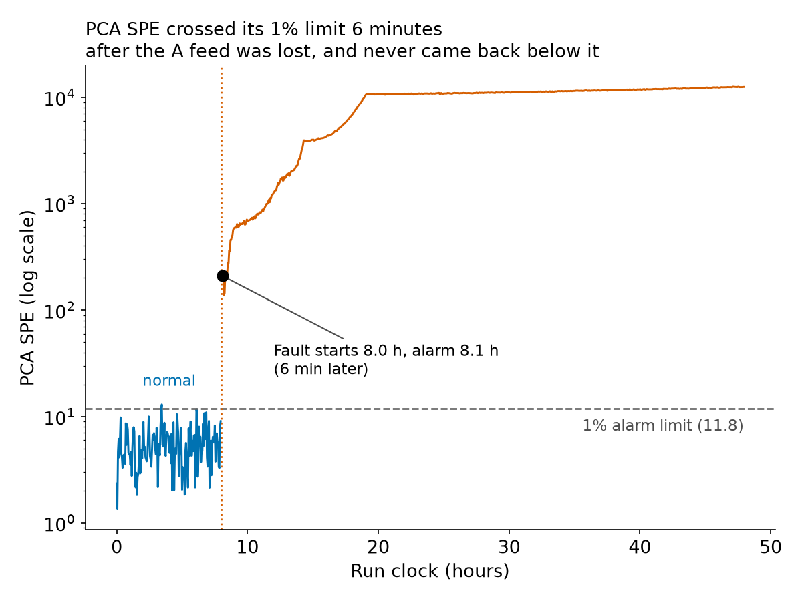
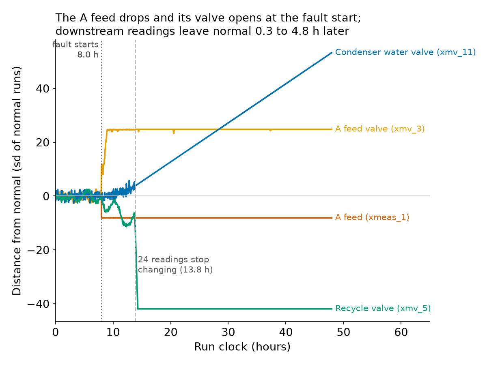

# Shift handover: fault 6 (A feed loss), testing run 1

A simulated plant, public Tennessee Eastman data. One testing run of fault 6; times are hours on the run clock (0 h is the first sample, one sample every 3 minutes). Run 1 is the first run ID in `phase-4/test_runs.json`; it was not picked by how it looks.

## Situation

- The PCA SPE monitor raised its alarm at **8.1 h**: three samples in a row above its 1% limit (11.8).
- The A feed was lost at **8.0 h**. The alarm came **0.1 h (6 minutes)** later.
- SPE stayed above the limit in 100% of the samples after the alarm and peaked at 12,531, 1,062 times the limit; the alarm never cleared. One sample before the fault (sample 70) was above the limit; a single sample does not raise an alarm.

## What the readings show

| Reading | Normal (mean, 1 sd) | Hour before the fault | End of run | Left its normal band |
|---|---|---|---|---|
| A feed (xmeas_1), kscmh | 0.25 (sd 0.03) | 0.27 | 0 | at once |
| A feed flow (xmv_3), % | 24.6 (sd 3.0) | 26.7 | 100.0 | at once |
| Condenser cooling water flow (xmv_11), % | 18.1 (sd 1.5) | 18.3 | 96.0 | 4.8 h after the start |
| Compressor recycle valve (xmv_5), % | 22.2 (sd 0.53) | 21.4 | -0.03 | 0.3 h after the start |

- The A feed reading (xmeas_1) fell from about 0.27 to 0 kscmh in the first faulty sample.
- Its valve (xmv_3) went from about 26.7% to fully open (100%) by the end of the run. That fits a controller asking for more A feed and not getting it. The data do not say why.
- Condenser cooling water flow (xmv_11) left its normal band 4.8 h after the fault start and was at 96.0% at the end. Compressor recycle valve (xmv_5) left it 0.3 h after the start and was at -0.03% at the end. Both are among the top whole-window readings in `phase-4/top_readings_6.csv`, chosen by their blame rank among readings outside the feeds area that really leave their band here.
- Stripper underflow (xmeas_17) is second in the blame list from the development runs, but in this run it stays inside its normal band (end of run 22.3 m3/h, normal 22.9, sd 0.62), so it is not drawn. SPE measures how a reading breaks away from the pattern of the others, not how far it moved.
- From 13.8 h (sample 277) on, 24 of the 52 readings, reactor pressure among them (3000.0 kPa gauge, close to the plant's published shutdown limit (not verified here)), stay at one fixed value for the rest of the run. This looks like the simulator's pressure shutdown regime; we did not check the cause. Valve positions still move after that point, but the measurements they respond to do not.

## Where to look first

Top five readings by relative SPE contribution (how much a reading adds to SPE, divided by what it adds on normal runs; about 1 is normal). The window starts at the alarm.

**First hour after the alarm (8.1 h to 9.1 h):**

| Rank | Reading | Unit | Plant area | Relative SPE contribution |
|---|---|---|---|---|
| 1 | A feed flow (xmv_3) | % | feeds | 11,376 x normal |
| 2 | A feed (xmeas_1) | kscmh | feeds | 10,484 x normal |
| 3 | Compressor work (xmeas_20) | kW | compressor / recycle | 79 x normal |
| 4 | Recycle flow (xmeas_5) | kscmh | compressor / recycle | 39 x normal |
| 5 | Compressor recycle valve (xmv_5) | % | compressor / recycle | 30 x normal |

**Whole window (8.1 h to 48 h):**

| Rank | Reading | Unit | Plant area | Relative SPE contribution |
|---|---|---|---|---|
| 1 | Condenser cooling water flow (xmv_11) | % | condenser / separator | 193,183 x normal |
| 2 | Stripper underflow (xmeas_17) | m3/h | stripper | 192,175 x normal |
| 3 | A feed (xmeas_1) | kscmh | feeds | 27,334 x normal |
| 4 | Reactor temperature (xmeas_9) | deg C | reactor | 15,369 x normal |
| 5 | Reactor cooling water flow (xmv_10) | % | reactor | 14,214 x normal |

Why they differ: the main reason is the shutdown tail, not downstream spread. 86% of the whole window comes after 13.8 h, when 24 readings stop changing and reactor pressure sits at 3000.0 kPa gauge, close to the plant's published shutdown limit (not verified here). A whole-window average is mostly that stretch. Reactor pressure reaches 2990 kPa or more after the fault start in 100% of the 100 fixed testing runs of fault 6, at a median of sample 277 (`pressure_tail.csv`). Some symptoms do move downstream before that point (see the readings table: Condenser cooling water flow (xmv_11) 4.8 h after the start, Compressor recycle valve (xmv_5) 0.3 h after the start), but that is the smaller part. Right after the alarm the feed readings are by far the most out of line, which is why the first-hour list is the fairer view. Across the 100 fixed testing runs of fault 6 the top SPE reading is a feed reading in 100% of them in the first hour and in 22% over the whole post-fault window (`phase-4/test_blame.csv`, windows counted from the fault start).

## What this does and doesn't tell you

- Contribution plots point at symptoms, not causes. They say where the monitor sees the plant break away from normal, not why.
- What a process engineer would check next, limited to what the public TEP description gives (the A feed stream, its valve, the feed controller):
  - the A feed stream reading (xmeas_1): is it really at zero, and is the stream really lost? In the public disturbance list this pattern is disturbance 6, A feed loss (stream 1); we know the label only because this is a labelled simulation;
  - its valve (xmv_3): is it still fully open (100%), with the flow still at zero;
  - the controller that moves that valve: the public notes say controllers move the four feed valves but not how the loops are paired, so we cannot say which target it is chasing.
- Three things we cannot say:
  1. **Why the A feed was lost.** The data show the reading and the valve, not whether the cause is a supply, a line or an instrument problem.
  2. **That this is fault 6 and nothing else.** An A feed reading also leads the first-hour blame, in the median of 100 testing runs, for faults 3, 7, 14, 17 (`phase-4/test_blame.csv`, top three SPE readings). Fault 3 is noise-level and means nothing; the others (7, 14, 17) are real faults that share the symptom.
  3. **What the plant did after 13.8 h.** Many readings stop changing then, probably because the simulator's pressure shutdown regime has started (reactor pressure at 3000.0 kPa gauge, close to the plant's published shutdown limit (not verified here)). That stretch is 86% of the window from the alarm on, so it is probably not realistic plant behaviour, and it is the main reason the whole-window list above looks the way it does.
- This is one run. Over all 500 testing runs of fault 6 the same alarm rule gives a median delay of 9 minutes with 0% of runs never detected (`scorecard.csv`, PCA SPE, 1% limit). The scorecard counts delay in samples from sample 160, so this run reads 9 minutes there against 6 on the run clock.

## Evidence

- Run: fault 6, simulation run 1, from `data/processed/TEP_Faulty_Testing.parquet` (local data, not in git). Run IDs: [`phase-4/test_runs.json`](../phase-4/test_runs.json).
- Monitor: the saved PCA model, [`phase-2/pca.npz`](../phase-2/pca.npz) (no lags, 1% SPE limit 11.80, set on held-back normal training runs).
- Alarm rule: three samples in a row above the limit; the alarm time is the third. Fault start 8.0 h: the first faulty sample is sample 161, stamped 8.0 h.
- Normal band: 3 standard deviations of normal runs from the normal mean, three samples in a row. Normal mean and sd come from the 330 `fit` runs (the PCA scaler).
- Blame for the 100 testing runs: [`phase-4/test_blame.csv`](../phase-4/test_blame.csv). The readings chosen above: [`phase-4/top_readings_6.csv`](../phase-4/top_readings_6.csv) (development runs). Delay over 500 runs: [`scorecard.csv`](../scorecard.csv).
- Figures: [`figures/operator-fault6.png`](figures/operator-fault6.png), [`figures/operator-fault6-readings.png`](figures/operator-fault6-readings.png).

## How this was made

Built by `scripts/make_report.py` on laptop, Intel i5-1135G7, 7.7 GB RAM. Runtime 34.3 s, peak RAM 1.78 GB (the whole script, including the one fault 6 testing run it reads).
