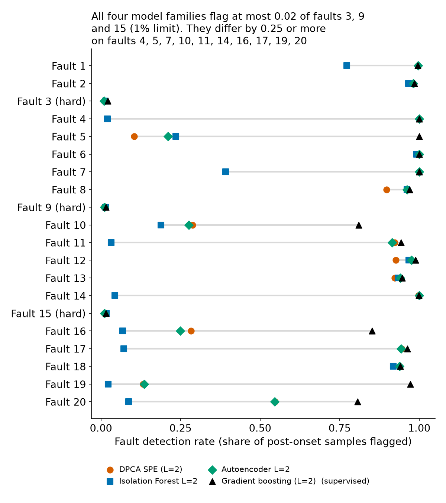
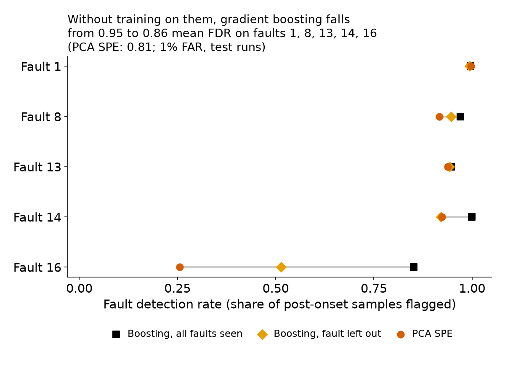
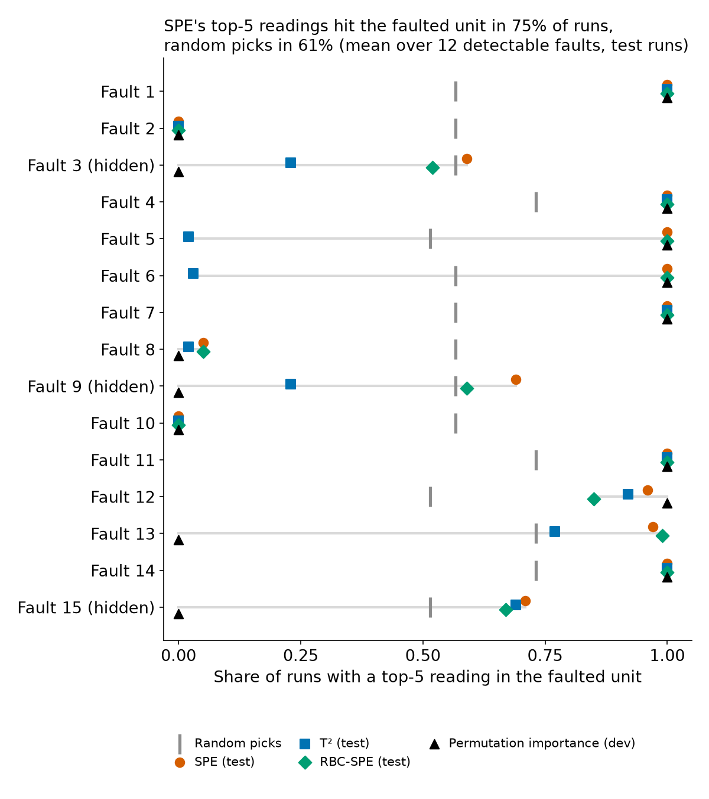
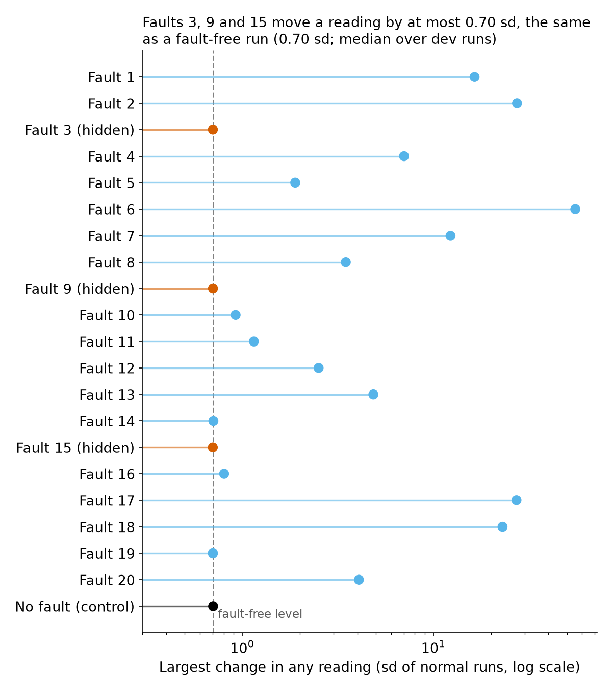

# TEP fault detection: comparison report

## What this is and what to take from it

We compared fault-detection models on the public Tennessee Eastman Process (TEP) simulation data, on one scorecard. Everything below was generated from saved results files by `scripts/make_report.py`; every table says where its numbers come from. Five things to take from it:

- **Detection at a 1% false-alarm limit.** The unsupervised models (they learn from normal runs only) flag 0.439 to 0.769 of post-onset samples on average without faults 3, 9, 15; Autoencoder L=2 is highest (0.769) and PCA SPE, the reference, reaches 0.737. Gradient boosting, the supervised model (it also learns from labelled faults), reaches 0.951. The two tracks have separate tables and are not ranked against each other. The top four unsupervised models sit within 0.032 of each other on one seed-42 split, so we call no winner among them.
- **Faults 3, 9 and 15 are not detected by any model.** Every model flags at most 0.021 of their post-onset samples, against a false-alarm rate of 0.009 to 0.012. Inside one run the readings after the fault start look like the readings before it, exactly as a fault-free run does. This is a result about these data, and the three faults sit at the false-alarm floor, as the literature reports.
- **Not seeing a fault costs the supervised model most on fault 16.** Retrained without faults 1, 8, 13, 14 and 16, it flags 0.863 of samples on those five, against 0.806 for PCA SPE, which uses no labels. Fault 16 carries 90% of that gap; on the other four the two are within 0.031. The model's settings were tuned with all 20 faults, including these five, so the unseen-fault result is mildly optimistic.
- **Contribution plots point at symptoms, not causes.** SPE's top five readings include the faulted plant area in 75% of runs, random picking in 61%; T² is no better than random. For fault 6 (A feed loss) a feed reading (the A feed or its valve) is the top SPE reading in 100% of runs in the first hour and 22% over the whole window, because downstream readings take over as the plant reacts.
- **The assistant scored higher with a trained classifier, which does not show better reasoning.** On the frozen cases it named the right plant area in 27 of 36 fault cases as v1 (95% interval 0.59 to 0.86) and 36 of 36 as v1.1 (0.90 to 1.00). v1.1 adds a supervised classifier trained on faults 1-20, and all 90 v1.1 sessions used it, so the gain is "a trained classifier helps" and the two cannot be separated. With only 36 headline cases the intervals are wide, and Claude may remember the published TEP papers. Answering 'normal' or 'can't tell' on faults 3, 9, 15 (9 of 9) is not a detection.

## Data and rules

**Data.** Rieth, Amsel, Tran and Cook (2017), simulated TEP runs, public. Each of 20 faults has 500 runs in a training file (500 samples per run, one sample every 3 minutes, fault starts after sample 20) and 500 in a testing file (960 samples, fault starts after sample 160). Fault-free files have 500 runs each. There are 52 readings per sample. A sample is labelled faulty only after the fault start (the **onset**); the samples before it in a faulty run are normal operation. The data are Rieth's, not the Braatz data most papers use.

**Why the run numbers are split into disjoint groups.** Run k of the fault-free file and of every fault in one file family share a noise stream. They are identical until the onset, and faults 3, 9 and 15 stay almost identical after it. Reusing a run number for two jobs would let a model memorise noise and make limits and tuning optimistic. So one seed-42 partition of the numbers 1-500 serves every training file, no run number serves two jobs, and a paired difference (faulty run k minus normal run k) is never a model input. All results here come from one seed-42 split; we did not repeat the split.

| Run group (training family) | Runs | Job |
|---|---|---|
| fit | 330 | Unsupervised models learn normal behaviour. The lag choice and autoencoder validation use these too, split by run. |
| limit | 100 | Set the alarm limits at 1% and 5% false-alarm rate. Nothing else. |
| limit_tune | 50 | Half of `limit`; also tunes the supervised model (with the dev runs). |
| supervised | 50 | Supervised training: faulty runs plus the normal runs with these IDs. |
| dev | 20 | Development runs: tuning and sanity checks. Never headline results. |
| testing files | 500 | All 500 runs per fault, once, for the scorecard. They share no noise stream with any training run. |

**Two tracks, never ranked together.** The *unsupervised* track (PCA, DPCA, Isolation Forest, autoencoder) learns from normal runs only. The *supervised* track (gradient boosting, 21 classes) also learns from labelled faulty runs. A supervised model is expected to look better on the 20 known faults and a real plant rarely has labels for its next fault, so each track has its own tables and the unseen-fault test below tries to show what labels buy.

**Alarm limits.** Each model's alarm limit is set on the 100 `limit` normal runs so that it false-alarms on 1% of normal samples (the headline) or 5% (secondary). Tables below use 1%. Test data never set a limit. PCA uses 31 PCs (90% of the variance) and no lags. The lag window is L = 2, one value for DPCA and the lagged models, chosen on normal runs with the Ku et al. (1995) rule. The choice is borderline: the last lag that added a new relation added 1, the next lag -1. Parallel analysis would have given L = 0; published TEP work uses 2 to 3 lags.

**Terms.**
- *FDR* (fault detection rate): share of post-onset samples of faulty runs that a model flags, counted per sample.
- *FAR* (false alarm rate): share of samples of fault-free test runs that a model flags.
- *T²*: how far a sample sits from normal along the patterns normal operation uses. *SPE*: how much of a sample falls outside those patterns.
- *Sustained alarm*: 3 samples in a row (9 minutes) above the limit. *Detection delay*: minutes from the onset to the third sample of the first sustained alarm after it.
- *Lag window L*: how many past samples a model sees besides the current one.

_Source: [`phase-1/run_split.json`](../phase-1/run_split.json), [`phase-2/lag_choice.csv`](../phase-2/lag_choice.csv), [`phase-2/pca.npz`](../phase-2/pca.npz)._

## Detection

All numbers are from the 500 testing runs per fault and the 500 fault-free testing runs, at the 1% alarm limit set on held-back normal training runs. Benchmark faults: 1 (A/C feed ratio step), 2 (B composition step), 4 (reactor cooling water inlet temperature step), 6 (A feed loss), 7 (C header pressure loss); 3, 9, 15 are the near-undetectable ones. Everything is one seed-42 split of the run numbers, so no table carries a run-to-run interval.

### Unsupervised track (normal runs only)

**Summary at the 1% limit.**

| Model | FAR | 3-in-a-row rate, fault-free | Mean FDR, all 20 faults | Mean FDR without 3, 9, 15 | Train time | Peak RAM |
|---|---|---|---|---|---|---|
| PCA T² | 0.010 | 17% | 0.563 | 0.660 | 0.7 s | 2.7 GB |
| PCA SPE | 0.010 | 5% | 0.628 | 0.737 | 0.7 s | 2.7 GB |
| DPCA T² (L=2) | 0.011 | 50% | 0.554 | 0.649 | 1.1 s | 2.7 GB |
| DPCA SPE (L=2) | 0.009 | 1% | 0.646 | 0.758 | 1.1 s | 2.7 GB |
| Isolation Forest L=0 | 0.011 | 39% | 0.375 | 0.439 | 0.6 s | 2.8 GB |
| Isolation Forest L=2 | 0.012 | 51% | 0.386 | 0.451 | 1.4 s | 2.8 GB |
| Autoencoder L=0 | 0.011 | 5% | 0.638 | 0.748 | 56 s | 2.8 GB |
| Autoencoder L=2 | 0.010 | 5% | 0.655 | 0.769 | 342 s | 2.8 GB |

**FDR on the five benchmark faults (1, 2, 4, 6, 7) and on the three hard ones (3, 9, 15).**

| Model | F1 | F2 | F4 | F6 | F7 | F3 | F9 | F15 |
|---|---|---|---|---|---|---|---|---|
| PCA T² | 0.994 | 0.987 | 0.377 | 0.991 | 1.000 | 0.011 | 0.011 | 0.013 |
| PCA SPE | 0.997 | 0.978 | 0.999 | 1.000 | 1.000 | 0.011 | 0.012 | 0.012 |
| DPCA T² (L=2) | 0.994 | 0.986 | 0.045 | 0.993 | 1.000 | 0.012 | 0.012 | 0.014 |
| DPCA SPE (L=2) | 0.997 | 0.978 | 1.000 | 1.000 | 1.000 | 0.010 | 0.010 | 0.011 |
| Isolation Forest L=0 | 0.661 | 0.967 | 0.022 | 0.991 | 0.373 | 0.012 | 0.013 | 0.015 |
| Isolation Forest L=2 | 0.773 | 0.966 | 0.021 | 0.991 | 0.392 | 0.013 | 0.015 | 0.017 |
| Autoencoder L=0 | 0.997 | 0.983 | 0.999 | 1.000 | 1.000 | 0.011 | 0.011 | 0.012 |
| Autoencoder L=2 | 0.997 | 0.982 | 1.000 | 1.000 | 1.000 | 0.010 | 0.011 | 0.011 |

**Detection delay: median minutes over detected runs (share of runs never detected).**

| Model | F1 | F2 | F4 | F6 | F7 | F3 | F9 | F15 |
|---|---|---|---|---|---|---|---|---|
| PCA T² | 24 min (0% never) | 42 min (0% never) | 21 min (0% never) | 33 min (0% never) | 9 min (0% never) | 1161 min (83% never) | 1083 min (83% never) | 1078 min (79% never) |
| PCA SPE | 15 min (0% never) | 57 min (0% never) | 12 min (0% never) | 9 min (0% never) | 9 min (0% never) | 1137 min (94% never) | 1137 min (95% never) | 1440 min (94% never) |
| DPCA T² (L=2) | 24 min (0% never) | 42 min (0% never) | 50 min (2% never) | 27 min (0% never) | 9 min (0% never) | 996 min (49% never) | 958 min (48% never) | 936 min (41% never) |
| DPCA SPE (L=2) | 18 min (0% never) | 69 min (0% never) | 9 min (0% never) | 9 min (0% never) | 9 min (0% never) | 876 min (99% never) | 876 min (99% never) | 664 min (100% never) |
| Isolation Forest L=0 | 27 min (0% never) | 93 min (0% never) | 849 min (45% never) | 30 min (0% never) | 15 min (0% never) | 1005 min (61% never) | 1017 min (59% never) | 954 min (54% never) |
| Isolation Forest L=2 | 27 min (0% never) | 92 min (0% never) | 840 min (36% never) | 30 min (0% never) | 15 min (0% never) | 942 min (50% never) | 972 min (46% never) | 873 min (45% never) |
| Autoencoder L=0 | 15 min (0% never) | 51 min (0% never) | 9 min (0% never) | 9 min (0% never) | 9 min (0% never) | 1578 min (96% never) | 1588 min (96% never) | 1444 min (94% never) |
| Autoencoder L=2 | 18 min (0% never) | 54 min (0% never) | 9 min (0% never) | 9 min (0% never) | 9 min (0% never) | 1098 min (95% never) | 1233 min (95% never) | 1098 min (93% never) |

### Supervised track (also uses labelled faults)

**Summary at the 1% limit.**

| Model | FAR | 3-in-a-row rate, fault-free | Mean FDR, all 20 faults | Mean FDR without 3, 9, 15 | Train time | Peak RAM |
|---|---|---|---|---|---|---|
| Gradient boosting (L=2) | 0.011 | 35% | 0.811 | 0.951 | 904 s | 2.8 GB |

**FDR on the five benchmark faults (1, 2, 4, 6, 7) and on the three hard ones (3, 9, 15).**

| Model | F1 | F2 | F4 | F6 | F7 | F3 | F9 | F15 |
|---|---|---|---|---|---|---|---|---|
| Gradient boosting (L=2) | 0.996 | 0.985 | 1.000 | 1.000 | 1.000 | 0.021 | 0.016 | 0.016 |

**Detection delay: median minutes over detected runs (share of runs never detected).**

| Model | F1 | F2 | F4 | F6 | F7 | F3 | F9 | F15 |
|---|---|---|---|---|---|---|---|---|
| Gradient boosting (L=2) | 18 min (0% never) | 45 min (0% never) | 9 min (0% never) | 9 min (0% never) | 9 min (0% never) | 1038 min (50% never) | 1116 min (54% never) | 975 min (58% never) |

Peak RAM is for the whole script that scored the model, not for the model alone. Machine for every row: laptop, Intel i5-1135G7, 7.7 GB RAM.



**How to read it.**
- Every FAR is between 0.009 and 0.012, so detection rates are compared at about equal false-alarm rate.
- PCA T² misses fault 4 (0.377) while PCA SPE catches it (0.999). T² looks at the size of normal-looking movement, SPE at broken relationships between readings.
- The top four unsupervised models (Autoencoder L=2, DPCA SPE (L=2), Autoencoder L=0, PCA SPE) are within 0.032 of each other in mean FDR without 3, 9, 15. With one seed-42 split we do not call a winner among them. Adding lags (L = 2) changes the autoencoder by 0.021 and Isolation Forest by 0.012.
- The 5% limit (secondary) and the textbook 99% limit are in `scorecard.csv`. The textbook limit can miss its target: DPCA SPE with it has a FAR of 0.049, not 0.010, which is why the tables use limits set on held-back normal runs.
- Isolation Forest is the weakest unsupervised model; it misses fault 4 (0.022) and runs it never detects reach 45%.
- False-alarm streaks: the per-sample FAR is about 1% for every model, but alarms come in runs. The share of fault-free runs with a 3-in-a-row alarm after sample 160 is 50% for DPCA T², 39% to 51% for Isolation Forest and 35% for gradient boosting, against 5% for PCA SPE. A detection delay from a model with a high streak rate is therefore less trustworthy, and a run is easily "detected" by chance.
- Faults 3, 9, 15 are not detected. The highest FDR on any of them is 0.021, against FARs near 0.01. For PCA T², 17% of fault-3 runs show a sustained alarm after the onset, and 17% of fault-free runs do. Gradient boosting's FDR on them (0.021, 0.016, 0.016) is a little above its FAR (0.011) and still nowhere near a detection; the phase 3 leak audit found no leak.

**Caveats for the supervised row.** Gradient boosting was fitted on every 3rd row (row stride 3, all 50 supervised runs kept) to keep the tuning grid short; scoring, limits and tuning scores use every row. Its tuning used the development runs of all 20 faults. 2 of the 8 grid fits are degenerate (their 1% limit saturates at 1.0, so FDR reads about 0) and the selection rule discarded them. The train time (904 s) is one fit; the whole grid took 6528 s. A published unsupervised DPCA variant reaches a mean of 0.951 on 18 faults without 3, 9, 15 on the Braatz data (computed from `research/pca-anchors.md`), so 0.95 is not extraordinary.

Earlier figures that already show this: [PCA and DPCA per fault](../phase-2/figures/fdr-by-fault.png), [PCA SPE, Isolation Forest and autoencoder per fault](../phase-3/figures/fdr-by-fault-unsupervised.png).

_Source: [`scorecard.csv`](../scorecard.csv), [`phase-3/hgb_tuning.csv`](../phase-3/hgb_tuning.csv), [`phase-3/models.json`](../phase-3/models.json)._ Plus `research/pca-anchors.md` for the 0.951.

## Against the literature

Rato and Reis (2013) report FDR per fault for PCA and DPCA at a 1% false-alarm limit. Ours are the same models at our 1% limit.

| Fault | PCA T² ours | PCA T² R&R | PCA SPE ours | PCA SPE R&R | DPCA T² ours | DPCA T² R&R | DPCA SPE ours | DPCA SPE R&R |
|---|---|---|---|---|---|---|---|---|
| 1 | 0.994 | 0.991 | 0.997 | 0.995 | 0.994 | 0.990 | 0.997 | 0.994 |
| 2 | 0.987 | 0.985 | 0.978 | 0.984 | 0.986 | 0.984 | 0.978 | 0.981 |
| 3 | 0.011 | 0.036 | 0.011 | 0.006 | 0.012 | 0.035 | 0.010 | 0.010 |
| 4 | 0.377 | 0.218 | 0.999 | 0.980 | 0.045 | 0.165 | 1.000 | 0.999 |
| 5 | 0.235 | 0.257 | 0.151 | 0.217 | 0.243 | 0.293 | 0.104 | 0.228 |
| 6 | 0.991 | 0.989 | 1.000 | 0.999 | 0.993 | 0.989 | 1.000 | 0.999 |
| 7 | 1.000 | 0.999 | 1.000 | 0.999 | 1.000 | 0.986 | 1.000 | 0.999 |
| 8 | 0.970 | 0.974 | 0.916 | 0.968 | 0.971 | 0.973 | 0.897 | 0.974 |
| 9 | 0.011 | 0.034 | 0.012 | 0.010 | 0.012 | 0.030 | 0.010 | 0.002 |
| 10 | 0.183 | 0.367 | 0.330 | 0.154 | 0.184 | 0.439 | 0.288 | 0.172 |
| 11 | 0.486 | 0.414 | 0.602 | 0.638 | 0.278 | 0.340 | 0.923 | 0.829 |
| 12 | 0.980 | 0.985 | 0.947 | 0.925 | 0.987 | 0.990 | 0.926 | 0.964 |
| 13 | 0.938 | 0.943 | 0.938 | 0.950 | 0.942 | 0.943 | 0.923 | 0.950 |
| 14 | 0.994 | 0.988 | 0.924 | 0.999 | 0.998 | 0.990 | 0.998 | 0.999 |
| 15 | 0.013 | 0.035 | 0.012 | 0.007 | 0.014 | 0.059 | 0.011 | 0.009 |
| 16 | 0.063 | 0.174 | 0.256 | 0.137 | 0.059 | 0.217 | 0.283 | 0.145 |
| 17 | 0.751 | 0.787 | 0.924 | 0.905 | 0.801 | 0.790 | 0.945 | 0.953 |
| 18 | 0.928 | 0.893 | 0.937 | 0.901 | 0.928 | 0.890 | 0.939 | 0.898 |
| 19 | 0.105 | 0.115 | 0.086 | 0.059 | 0.246 | 0.046 | 0.133 | 0.298 |
| 20 | 0.238 | 0.340 | 0.536 | 0.423 | 0.385 | 0.408 | 0.547 | 0.493 |
| Mean, 20 faults | 0.563 | 0.576 | 0.628 | 0.613 | 0.554 | 0.578 | 0.646 | 0.645 |
| Mean without 3, 9, 15 | 0.660 | 0.672 | 0.737 | 0.720 | 0.649 | 0.673 | 0.758 | 0.757 |

**What differs, so read the gaps with care.**
- Their data are the original Braatz data: one run per fault, 960 samples, fault from sample 160. Ours are Rieth's: 500 runs per fault, so our numbers average 500 runs. Theirs carry single-run noise; a gap of a few points is not a finding.
- Their limits were set by trial to a 1% false-alarm rate on a second fault-free data set. Ours come from 100 held-back normal runs.
- Their PCA keeps 17 PCs (parallel analysis) and DPCA 3 lags and 29 PCs. Ours keeps 31 PCs (90% of the variance) and DPCA 2 lags and 68 PCs. Their FDR definition is not fully stated in the paper.
- Their table has 21 faults; Rieth's data have 20, so means are over the 20 shared faults.

**What agrees.** The means over the 20 faults are within 0.024 of theirs for every statistic. T² misses fault 4 in both and SPE catches it; faults 3, 9, 15 sit near the false-alarm floor in both; faults 5, 10, 16, 19, 20 are weak for static PCA in both. Differences of 0.10 or more fall on faults 4, 5, 10, 16, 19, 20, the faults where these monitors are weak or T² and SPE disagree. With one run per fault on their side and a different limit procedure on ours, we do not read them as a disagreement.

_Source: [`phase-2/vs_literature.csv`](../phase-2/vs_literature.csv), [`scorecard.csv`](../scorecard.csv)._ Published numbers: Rato and Reis (2013), Chemometrics and Intelligent Laboratory Systems 125:101-108, Table 2, as saved in `vs_literature.csv`; their PC and lag counts are from `research/pca-anchors.md`.

## The unseen-fault test

The supervised model was retrained once without faults 1, 8, 13, 14 and 16 (the lowest-numbered fault of each Downs and Vogel type, fixed before any results) and scored on those faults, next to the full supervised model and to PCA SPE, which never sees labels. Same 1% limit, same testing runs.

| Fault | Supervised, fault unseen | Supervised, all faults | PCA SPE (no labels) | Unseen minus PCA SPE |
|---|---|---|---|---|
| 1 | 0.993 | 0.996 | 0.997 | -0.004 |
| 8 | 0.947 | 0.970 | 0.916 | +0.031 |
| 13 | 0.942 | 0.946 | 0.938 | +0.004 |
| 14 | 0.921 | 0.999 | 0.924 | -0.002 |
| 16 | 0.513 | 0.852 | 0.256 | +0.258 |
| Mean, 5 faults | 0.863 | 0.953 | 0.806 | +0.057 |

- Without labels for them the supervised model flags 0.863 of samples on these five, against 0.953 when it saw them and 0.806 for PCA SPE.
- **Fault 16 carries the gap.** It holds 90% of the unseen model's lead over PCA SPE. On faults 1, 8, 13 and 14 the two are within 0.031 of each other. Without fault 16 the means are 0.951 (unseen) and 0.944 (PCA SPE). Fault 14 is the other one labels clearly help: the unseen model drops from 0.999 to 0.921, no better than PCA SPE.
- Caveats. The unseen model reuses the full model's settings, which were tuned with all 20 faults, including these five, so this test is mildly optimistic for the unseen model. Both supervised models are fitted on every 3rd row. It is one seed-42 split with one retrain, so there is no interval on these numbers. Fault 16's cause is unknown (Downs and Vogel give no description).



_Source: [`phase-3/unseen_fault.csv`](../phase-3/unseen_fault.csv), [`scorecard.csv`](../scorecard.csv)._

## Diagnosis

**What blame is.** An alarm says something is wrong; blame says which readings the alarm statistic points at. For each reading we take its contribution to SPE (or T²) over a window and divide it by what it contributes on normal runs. About 1 is normal; a high value marks a reading to look at. It shows where the symptoms are, not where the cause is, because contributions smear across correlated readings. We score it as *top-5 hit*: a top-5 reading sits in the plant area the fault belongs to (a fixed fault-to-area map), next to what random picking scores.

**Which method blames the right area.** Means over the 12 detectable faults that have a known area (1, 2, 4, 5, 6, 7, 8, 10, 11, 12, 13, 14), whole post-onset window:

| Method | Top reading in faulted area | Top-5 includes faulted area | Share of blame in faulted area |
|---|---|---|---|
| SPE (test runs) | 0.51 | 0.75 | 0.34 |
| T² (test runs) | 0.43 | 0.56 | 0.31 |
| RBC-SPE (test runs) | 0.51 | 0.74 | 0.33 |
| RBC-T² (test runs) | 0.48 | 0.52 | 0.31 |
| Permutation importance (dev runs, one vector per fault) | 0.50 | 0.67 | 0.52 |
| Random picking | 0.18 | 0.61 | 0.18 |

- SPE blames best of the PCA views: its top five include the faulted area in 75% of runs, 14 points above random picking (61%). T² is no better than random on that measure.
- RBC (reconstruction-based contribution) for SPE gives the same ranking as plain SPE contributions in the relative form, by algebra, so it adds nothing; they differ only where a 1% floor applies.
- The permutation row is coarse: it comes from the development runs only, with one dev vector per fault, so each fault scores 0 or 1. The 8-hour permutation pass used every 5th post-onset sample (28681 s on the laptop, over the 3-hour guide) and was not rerun.
- The gain over chance is modest. Only 34% of SPE's blame lands in the right area.



_Footnote: the permutation-importance dots are dev runs, one importance vector per fault (each is 0 or 1); the PCA dots are testing runs. The chart title says "test runs" for the PCA views only._

**The fault 6 lesson: first hour against whole window.** For fault 6 (A feed loss) the top SPE reading is a feed reading in 100% of the 100 testing runs in the first hour after the onset (the median top three are A feed flow (xmv_3); A feed (xmeas_1); Compressor work (xmeas_20)), and in 22% over the whole post-onset window (median top three: Condenser cooling water flow (xmv_11); Stripper underflow (xmeas_17); A feed (xmeas_1)). The A feed is lost at once; later the plant reacts, and downstream readings dominate a whole-window average. Both windows have a feed reading among the top five in 100% of runs. The window, not the method, decides what the plot says. [The operator report](operator-fault6.md) shows this on one run.

**Where blame misses.** SPE's top-5 hit rate is at or below 0.05 on faults 2, 8, 10:

  - Fault 2: top-5 hit rate 0.00 against 0.57 for random picking. SPE's top readings are Condenser cooling water flow (xmv_11); Stripper underflow (xmeas_17); Stripper steam flow (xmeas_19).
  - Fault 8: top-5 hit rate 0.05 against 0.57 for random picking. SPE's top readings are Compressor work (xmeas_20); Stripper pressure (xmeas_16); Stripper steam valve (xmv_9).
  - Fault 10: top-5 hit rate 0.00 against 0.57 for random picking. SPE's top readings are Stripper temperature (xmeas_18); Stripper steam flow (xmeas_19); Stripper steam valve (xmv_9).

These are results about contribution plots (symptoms, not causes), not a fault in the method.

**Why faults 3, 9 and 15 hide.** Inside one run, we compare the 160 samples before the fault start with the 800 after, on three statistics: the largest shift of any reading (in standard deviations of normal runs), the largest change in spread and the largest change in autocorrelation. The control is 100 fault-free testing runs that share no noise stream with the faulty ones.

| Fault | Largest shift (sd) | Largest spread ratio | Largest change in autocorrelation |
|---|---|---|---|
| Fault-free control | 0.47 | 2.09 | 0.25 |
| 3 | 0.47 | 2.04 | 0.24 |
| 9 | 0.47 | 2.10 | 0.25 |
| 15 | 0.46 | 2.10 | 0.25 |
| 14 | 0.47 | 14.07 | 1.23 |
| 19 | 0.47 | 2.58 | 0.39 |

- Faults 3, 9, 15 sit at the control on all three: shift 0.46 to 0.47 against 0.47; spread 2.04 to 2.10 against 2.09; autocorrelation 0.24 to 0.25 against 0.25. There is no change inside the run for any monitor to find, and their blame hit rates (0.59, 0.69, 0.71) are near chance and mean nothing.
- Caution: the headline check is mean shift, and faults 10, 11, 14, 16, 19 also match the control on it. Faults 14 and 19 are the clearest example: fault 14 is easy to detect and shows no mean shift (0.47 sd), but its spread ratio is 14.07 against 2.09. So mean shift alone proves nothing; for 3, 9, 15 all three statistics are at the control level, and that is what supports "hidden".



See also [the blame heatmap](../phase-4/figures/blame-heatmap.png).

_Source: [`phase-4/test_blame.csv`](../phase-4/test_blame.csv), [`phase-4/dev_blame.csv`](../phase-4/dev_blame.csv), [`phase-4/test_hidden.csv`](../phase-4/test_hidden.csv), [`phase-4/README.md`](../phase-4/README.md)._

## The assistant

The assistant is Claude with one tool server that reads a replayed plant history for one case. It sees the 52 readings, a PCA alarm log and public plant notes. It answers with a fixed block: status (fault, normal or can't tell), plant area, up to three disturbance guesses (IDV numbers) and evidence. It is scored on 70 frozen cases from the testing runs (3 runs per fault and 10 normal, neutral IDs, so the fault, run number and onset are hidden), each in a fresh session with no file or web access. *Unit accuracy* is the share of fault cases (not 3, 9, 15 or 16-20) where it says "fault" and names the right plant area.

| Measure | v1 (PCA tools only) | v1.1 (adds a trained classifier) | Cases fixed / broken |
|---|---|---|---|
| Unit accuracy (fault cases other than 3/9/15 and 16-20) | 27 / 36 = 0.75 [0.59, 0.86] | 36 / 36 = 1.00 [0.90, 1.00] | 9 / 0 |
| IDV top-1 (all fault cases) | 25 / 60 = 0.42 [0.30, 0.54] | 51 / 60 = 0.85 [0.74, 0.92] | 26 / 0 |
| IDV top-3 (all fault cases) | 35 / 60 = 0.58 [0.46, 0.70] | 51 / 60 = 0.85 [0.74, 0.92] | 16 / 0 |
| Normal cases called normal | 10 / 10 = 1.00 [0.72, 1.00] | 10 / 10 = 1.00 [0.72, 1.00] | 0 / 0 |
| Faults 3, 9, 15 answered 'normal' or 'can't tell' (not a detection) | 9 / 9 = 1.00 [0.70, 1.00] | 9 / 9 = 1.00 [0.70, 1.00] | 0 / 0 |
| No-LLM baseline (unit of the top SPE reading) | 15 / 36 = 0.42 | 15 / 36 = 0.42 |  |
| Chance (always the most common unit) | 18 / 36 = 0.50 | 18 / 36 = 0.50 |  |

- **Read v1.1 for what it is.** v1.1 adds `classify_fault`, a supervised closed-set classifier (gradient boosting trained on faults 1-20 plus normal). All 90 of 90 v1.1 test sessions used it, so there is no with-and-without comparison. The gain from 27 to 36 of 36 is "a trained classifier helps", not better reasoning, and v1.1 is not a reasoning-only score.
- **Wide intervals.** With 36 headline cases the 95% intervals above are wide. The intervals for v1 and v1.1 do not overlap, and each fault has only three cases.
- **Baselines.** The no-LLM baseline (15 of 36: unit of the top SPE reading) is below chance (18 of 36: always the most common unit), so the SPE reading alone is a poor guide to the plant area.
- **Faults 3, 9, 15.** The assistant answered "normal" or "can't tell" on all 9. That is the right answer for a fault with no visible change, and it is not a detection.
- **Repeats.** 10 cases were run 3 times. v1: 9 of 10 cases agree on status and plant area; v1.1: 10 of 10. Headline numbers use the first run of each case.
- **Cost.** v1 $4.19 for 90 sessions; v1.1 $2.88 for 90 sessions (API-equivalent cost reported by the CLI).
- **Memory of the papers.** Claude may remember the published TEP papers and their fault descriptions; no setting controls that, so a result here is not proof of reasoning from the data. The frozen prompt also mildly pushes toward finding a fault, which can flatter the fault cases.

_Source: [`phase-3/assistant_v1_vs_v1.1.csv`](../phase-3/assistant_v1_vs_v1.1.csv), [`phase-2b/diagnosis_test.csv`](../phase-2b/diagnosis_test.csv), [`phase-2b/diagnosis_test_v1.1.csv`](../phase-2b/diagnosis_test_v1.1.csv)._ Cost: result lines of `results/phase-2b/transcripts_test*/` (local files, not in git).

## What we did not do and what is uncertain

- **One seed-42 split.** One partition of the run numbers, one fit per model, no repeat over splits. No detection number has an interval; differences of a few points between models are not findings.
- **Rieth data, not Braatz data.** Most papers use the original Braatz data (one run per fault). Same faults, different noise and run counts, so compare patterns, not exact percentages.
- **Gradient boosting stride.** Fitted on every 3rd row (stride 3) to keep the grid short. 2 of 8 grid fits are degenerate (limit saturates at 1.0) and discarded by the rule. It was tuned with all 20 faults, so the unseen-fault test is mildly optimistic.
- **Few assistant cases.** 36 headline cases give wide intervals (v1: 0.59 to 0.86). Claude may remember the TEP papers. v1.1 includes a supervised classifier.
- **Permutation importance.** One dev vector per fault, every 5th post-onset sample, one process; the pass took about 8 hours, over the guide, and was not rerun.
- **False-alarm streaks.** DPCA T² has a 3-in-a-row rate of 50% on fault-free runs at the 1% limit, so its delays are less trustworthy.
- **Hidden-fault check.** Its headline is mean shift, which does not separate faults 14 and 19 from the control; spread and autocorrelation do.
- **Not done.** No new models or testing-file runs in this phase; no fault 21 (not in Rieth's data); no repeated splits or confidence intervals on the detection tables; no deep learning beyond a small scikit-learn autoencoder; no cloud runs.

## Reproduce it

Run from the project folder, in this order. Python is the project venv.

```
.venv/Scripts/python scripts/prepare_data.py          # download and convert the four files to parquet
.venv/Scripts/python -m src.split                     # the seed-42 run groups
.venv/Scripts/python scripts/mspc_dev.py              # PCA / DPCA on development runs (lag choice)
.venv/Scripts/python scripts/mspc_final.py            # PCA / DPCA on the testing files, scorecard rows
.venv/Scripts/python scripts/ml_dev.py                # Isolation Forest, autoencoder, gradient boosting tuning
.venv/Scripts/python scripts/ml_final.py              # the same on the testing files, unseen-fault test
.venv/Scripts/python scripts/assistant_build.py       # case sets and historians (the test set is frozen, it refuses a rebuild)
.venv/Scripts/python scripts/assistant_eval.py --version v1.1 --set test   # assistant sessions (already run; needs the Claude CLI and costs money)
.venv/Scripts/python scripts/assistant_score.py --set test --version v1.1
.venv/Scripts/python scripts/diagnose_dev.py          # permutation importance on dev runs (about 8 hours)
.venv/Scripts/python scripts/diagnose_final.py        # blame and hidden-fault tables on the testing files
.venv/Scripts/python scripts/make_report.py           # these two reports and their charts
.venv/Scripts/python -m pytest -q                     # the tests
```

`make_report.py` only reads saved results files, except for one fault 6 testing run it reads from the parquet file and scores with the saved PCA model. It overwrites everything in `results/report/`.

## How this was made

Built by `scripts/make_report.py` on laptop, Intel i5-1135G7, 7.7 GB RAM. Runtime 6.3 s, peak RAM 0.52 GB (the whole script, including the one fault 6 testing run it reads).
